# 김성주 (Sungjoo Kim)

**AI & Computer Vision Engineer**

 

> **"데이터 전처리부터 모델 설계, 경량화 및 추론 최적화까지 비정형 AI 파이프라인의 전 주기를 엔지니어링합니다."**  
> 가톨릭대학교 정보통신전자공학부 졸업 (전공 4.02 / 4.5) ㆍ 네이버 커넥트재단 부스트캠프 AI Tech 7기 (CV Track) 수료

---

## ⚡ Core Competencies

- **Full-Cycle AI Pipeline Engineering**: 컴퓨터 비전(분류, 객체 탐지, 세그멘테이션, OCR)과 멀티모달 오디오-언어모델 등 5대 비정형 AI 프로젝트를 완수하며 모델 설계 및 성능 개선의 전 주기를 주도했습니다.
- **Model Compression & Low-Latency Serving**: LoRA/VB-LoRA, 4-bit NF4 양자화, Flash Attention 2 적용으로 피크 VRAM을 **35.0% 절감(9.18GB → 5.96GB)**하여 단일 8GB GPU 환경에서 무중단 추론을 구현했습니다.
- **Data-Centric AI & Pipeline Acceleration**: I/O 병목을 제거하는 Pickle 전처리 직렬화로 학습 시간을 **50% 단축(8h → 4h)**시켰으며, 3단계 시각화 검증으로 중복 증강 버그를 규명하여 OCR **F1-Score 0.78166**을 달성했습니다.
- **Academic Research & Patent**: 신호처리연구실 학부연구생으로 U-Net 기반 디블러링 연구를 주도하여 **KIEE 학술지 논문 게재(공저자)** 및 **특허 출원 1건**을 완료했습니다.

---

## 🛠 Tech Stack

| 분류 | 기술 스택 |
|:---|:---|
| **Languages** |     |
| **Frameworks** |      |
| **Optimization & PEFT** | -FF6F00?style=flat-square) -0A85EA?style=flat-square)   |
| **Data & Pipeline** |     |
| **DevOps & Tools** | -FCC624?style=flat-square&logo=linux&logoColor=black)      |

---

## 🚀 Featured Projects

| 프로젝트명 | 기간 / 구분 | 핵심 기술 | 핵심 성과 (Before → After) | Repository |
|---|:---:|---|---|:---:|
| **오디오 언어모델 경량화 및 추론 최적화** | 2025.01 ~ 2025.02 5인 팀 (**팀 리더**) | `SALMONN`, `LLaMA-3.2 3B`, `Whisper-v3`, `4-bit NF4`, `VB-LoRA`, `Flash Attention 2` | • 피크 VRAM **35.0% 절감** (9.18GB → 5.96GB, 8GB GPU 서빙) • SPIDEr **+58.8%** (0.2027 → 0.3218) • WER **-7.7% error** (0.0634 → 0.0585) | [Code](https://github.com/kimmaru/level4-cv-finalproject-hackathon-cv-20-lv3) |
| **Hand Bone Image Semantic Segmentation** | 2024.11 ~ 2024.12 6인 팀 | `PyTorch AMP`, `UPerNet`, `SegFormer`, `Swin`, `Lion Optimizer`, `Streamlit` | • 학습 시간 **14.0% 단축** (41m → 36m40s) via AMP • Lion 도입 **Dice 0.94559** (vs Adam 0.88489) • 최종 앙상블 **Dice ~0.97** 달성 | [Code](https://github.com/kimmaru/level2-cv-semanticsegmentation-cv-20-lv3) |
| **Data-Centric OCR Text Detection** | 2024.11 ~ 2024.11 6인 팀 | `EAST`, `Pickle Serialization`, `UFO Format`, `Albumentations`, `CVAT` | • I/O 병목 해소로 학습 시간 **50% 단축** (8h → 4h) • 3단계 시각화로 중복 증강 버그 규명 및 정상 복구 • 정규화/이진화 전처리로 **F1-Score 0.78166** 달성 | [Code](https://github.com/kimmaru/level2-cv-datacentric-cv-21) |
| **Recycle Object Detection** | 2024.10 ~ 2024.11 6인 팀 | `YOLOv11`, `RT-DETR`, `Cascade R-CNN`, `Swin`, `WBF Ensemble` | • 소형 객체 특화 멀티스케일 증강 전략 도출 • Swin 백본 TTA 적용으로 **성능 +5%p 향상** • 1-stage & 2-stage 결합 WBF 앙상블 파이프라인 구축 | [Code](https://github.com/kimmaru/level2-objectdetection-cv-21) |
| **Sketch Image Classification** | 2024.09 ~ 2024.09 6인 팀 | `DeiT3-Large`, `ViT`, `timm`, `Mixup`, `CutMix`, `Label Smoothing`, `TTA` | • 선화 특화 증강으로 정확도 **+1.5%p 향상** • DeiT3-Large + Soft Voting으로 **최종 Accuracy 90.3%** 달성 | [Code](https://github.com/kimmaru/level1-imageclassification-cv-21) |

---

### 1. 오디오 언어모델 경량 모델링 및 추론 효율화
> **부스트캠프 AI Tech 7기 최종 해커톤 (Nota 기업 연계) | 2025.01 ~ 2025.02 (5인 팀, 팀 리더)**  
> 🔗 **Repository**: [level4-cv-finalproject-hackathon-cv-20-lv3](https://github.com/kimmaru/level4-cv-finalproject-hackathon-cv-20-lv3)

- **배경 및 목표**: 대규모 멀티모달 오디오 언어모델(SALMONN 3B)의 높은 피크 VRAM(9.18GB)과 긴 추론 지연시간을 개선하여, 단일 8GB GPU 환경에서 OOM 없이 안정적으로 구동되는 경량 파이프라인 구축.
- **담당 역할**: **팀 리더**로서 전체 실험 로드맵 수립 및 가설 검증 총괄, 오디오 전처리 파이프라인 구축, Whisper-large-v3 교체 및 노이즈 제거 실험, 모델 경량화(LoRA/VB-LoRA, 4-bit Quantization, Flash Attention 2) 탐색.
- **핵심 엔지니어링 & 성과**:
  - **VRAM 35.0% 절감 (9.18GB → 5.96GB)**: BitsAndBytes 4-bit NF4 중첩 양자화와 Flash Attention 2를 연동하여 단일 8GB GPU 환경에서 OOM 없는 안정적 추론 구현.
  - **음성 인식 정확도 개선**: Whisper-large-v3 인코더 교체 및 `noisereduce` 전처리를 통해 **WER 7.7% 감소 (0.0634 → 0.0585)**.
  - **오디오 캡셔닝 품질 극대화**: 오디오 캡셔닝 지표인 **SPIDEr 점수 58.8% 향상 (0.2027 → 0.3218)**.
  - **설계 판단**: LLM 백본을 Vicuna에서 LLaMA-3.2 3B로 교체하여 지연시간과 정확도의 균형을 확보하고, VeRA 대비 음성인식 저하가 적은 VB-LoRA를 최종 선정.

---

### 2. Hand Bone Image Semantic Segmentation (손 X-Ray 29개 뼈 영역 분할)
> **부스트캠프 AI Tech 7기 | 2024.11 ~ 2024.12 (6인 팀)**  
> 🔗 **Repository**: [level2-cv-semanticsegmentation-cv-20-lv3](https://github.com/kimmaru/level2-cv-semanticsegmentation-cv-20-lv3)

- **배경 및 목표**: 손 X-Ray 800장의 한정된 고해상도 의료 영상에서 서로 인접한 29개 미세 수근골 및 지골 구조의 경계를 픽셀 단위로 정밀 분할.
- **담당 역할**: PyTorch AMP 도입을 통한 학습 연산 가속, 옵티마이저 탐색, 의료 영상 맞춤형 전처리/증강 기법 개발, TTA 및 앙상블 파이프라인 구현.
- **핵심 엔지니어링 & 성과**:
  - **학습 연산 속도 14.0% 단축**: `torch.cuda.amp.autocast()` 및 `GradScaler()`를 학습 루프에 직접 이식하여 20에폭 기준 학습 시간을 **41분에서 36분 40초로 14.0% 단축**하고 VRAM 마진 확보.
  - **옵티마이저 최적화**: 부호 모멘텀 기반 Lion 옵티마이저(lr=1e-4)를 도입하여 기존 Adam(0.88489) 대비 **Dice Score 0.94559** 달성.
  - **최종 일반화 성능**: UPerNet Swin 백본 및 Soft-Voting 앙상블을 적용하여 최종 **Dice Score ~0.97 수준** 확보.
  - **에러 분석 대시보드**: 오분할 세그먼트를 즉시 검증할 수 있는 Streamlit 기반 인터랙티브 분석 대시보드 연동.

---

### 3. Data-Centric OCR Text Detection (데이터 중심 글자 검출)
> **부스트캠프 AI Tech 7기 | 2024.11 ~ 2024.11 (6인 팀)**  
> 🔗 **Repository**: [level2-cv-datacentric-cv-21](https://github.com/kimmaru/level2-cv-datacentric-cv-21)

- **배경 및 목표**: 영수증 및 문서 이미지 내 다국어 글자 검출 시 모델 아키텍처(EAST)를 고정한 상태에서 데이터 품질 정제, 라벨링 검수, 파이프라인 최적화만으로 F1-Score 극대화.
- **담당 역할**: 9개 데이터 품질 태그 정의 및 어노테이션 가이드라인 정립, 고해상도 이미지 전처리 직렬화(Pickle) 개발, 중복 증강 버그 디버깅.
- **핵심 엔지니어링 & 성과**:
  - **학습 소요 시간 50% 단축 (8시간 → 4시간)**: 매 에폭마다 수만 개의 UFO JSON 폴리곤 좌표를 파싱하고 리사이즈하던 CPU/IO 병목을 해결하기 위해, `to_pickle.py`를 제작해 사전 1회 캐싱함으로써 실험 회전율 2배 개선.
  - **3단계 시각화로 치명적 버그 해결**: 특정 증강 적용 시 F1-Score가 0.2대로 급락하는 원인을 밝히기 위해 `[원본 - 캐시 - 텐서]` 3단계 시각화 도구를 작성하여, 전처리와 로더에서 증강이 2중 적용되던 버그를 규명하고 로더 단계로 일원화 (0.2대 → 0.7대 상위권 정상 복구).
  - **검출 정확도 달성**: Test 데이터셋 통계량(Mean/Std)을 반영한 정규화 및 이진화 전처리를 적용하여 **F1-Score 0.78166** 달성.

---

### 4. Recycle Object Detection (재활용 쓰레기 10종 다중 객체 탐지)
> **부스트캠프 AI Tech 7기 | 2024.10 ~ 2024.11 (6인 팀)**  
> 🔗 **Repository**: [level2-objectdetection-cv-21](https://github.com/kimmaru/level2-objectdetection-cv-21)

- **배경 및 목표**: 10종의 재활용 쓰레기 이미지 내 심각한 클래스 불균형(`General trash` 3,500+ vs `Battery`/`Glass` 소수)과 소형 객체 오탐 극복.
- **담당 역할**: COCO 어노테이션 EDA 및 바운딩 박스 분포 분석, 생성형 데이터 증강 검증, Weighted Box Fusion(WBF) 앙상블 파이프라인 구현.
- **핵심 엔지니어링 & 성과**:
  - **소형 객체 멀티스케일 전략**: 너비/높이 0.2 이하 소형 객체 밀집 현상을 확인하고 멀티스케일 입력 증강 전략 수립.
  - **추론 신뢰도 향상**: Swin 백본 모델에 Test-Time Augmentation(TTA)을 적용하여 **탐지 성능 약 5%p 개선**.
  - **WBF 앙상블**: 1-stage(YOLOv11, RT-DETR)와 2-stage(Cascade R-CNN) 모델 예측값을 WBF로 결합해 경계면 오탐 최소화.
  - **실험적 교훈**: Controllable Diffusion 기반 합성 데이터 증강을 실험했으나 소형 객체 디테일 뭉개짐과 도메인 갭으로 인한 성능 저하를 확인, "도메인 일관성을 갖춘 데이터 품질이 최우선"이라는 데이터 철학 도출.

---

### 5. Sketch Image Classification (대규모 스케치 500종 분류)
> **부스트캠프 AI Tech 7기 | 2024.09 ~ 2024.09 (6인 팀)**  
> 🔗 **Repository**: [level1-imageclassification-cv-21](https://github.com/kimmaru/level1-imageclassification-cv-21)

- **배경 및 목표**: 색상과 질감이 결여된 500개 클래스의 흑백 스케치 선화 이미지를 고정밀 분류하기 위한 비전 트랜스포머 최적화.
- **담당 역할**: 스케치 데이터 특성 분석, 선화 특화 증강(Mixup, CutMix, Label Smoothing) 구현 및 튜닝, TTA 기반 앙상블 파이프라인 구축.
- **핵심 엔지니어링 & 성과**:
  - **선화 특화 증강으로 성능 개선**: 과도한 왜곡 전처리 대신 선화에 적합한 Mixup/CutMix 및 과신 방지 Label Smoothing을 적용하여 **정확도 약 1.5%p 향상**.
  - **최종 정확도 90.3% 달성**: DeiT Large 백본에 FiveCrop 기반 TTA와 Soft-Voting 앙상블을 결합하여 **Accuracy 90.3%** 달성.

---

## 📜 Research & Intellectual Property

### 학술지 논문 (Journal Paper)
- **New U-Net for Image Deblurring Using Deep Learning**  
  *The Transactions of the Korean Institute of Electrical Engineers (대한전기학회 논문지), Vol. 72, No. 7, pp. 843–848, 2023.07*  
  정우열, **김성주**, 이창우 (가톨릭대학교 신호처리연구실 공저)  
  
  - 병렬 Short-cut 구조(ResN1 블록)와 3단계 Pre/Post-processing을 설계하여 다운샘플링 채널 불일치를 해결하고, 기존 U-Net 대비 **PSNR 약 1dB 향상 및 고주파 디테일 복원력**을 입증.

### 지식재산권 (Patent)
- **딥러닝에 기반한 영상 디블러링 방법 (Image Deblurring Method Based on Deep Learning)**  
  *출원번호: 10-2023-0139485 | 출원인: 가톨릭대학교 산학협력단 (발명자 참여, 2023.10)*

---

## 💡 Other Projects

- **임베디드 엣지 기반 실시간 안면인식 스마트 출입 보안 시스템** (2023.02 ~ 2023.06, 캡스톤디자인 팀장)
  - Raspberry Pi 환경에서 OpenCV 및 경량 안면 검출 모델 포팅, 초음파 센서 및 서보모터 연동.
  - 근접 감지 → 얼굴 인증 → 도어 제어 → 방문자 감사 로그 기록의 전 주기 스마트 출입 제어 시스템 완성 및 전시.
- **Slack Export Viewer** (2025.02 ~ 2025.03, 개인 프로젝트)
  - Python 정규표현식(`re`) 기반 대용량 텍스트 파싱 파이프라인 및 카드형 탐색 UI 구축, Playwright E2E 자동 테스트 구현.

---

## 📊 GitHub Analytics

  

---

### Contact & Channels

